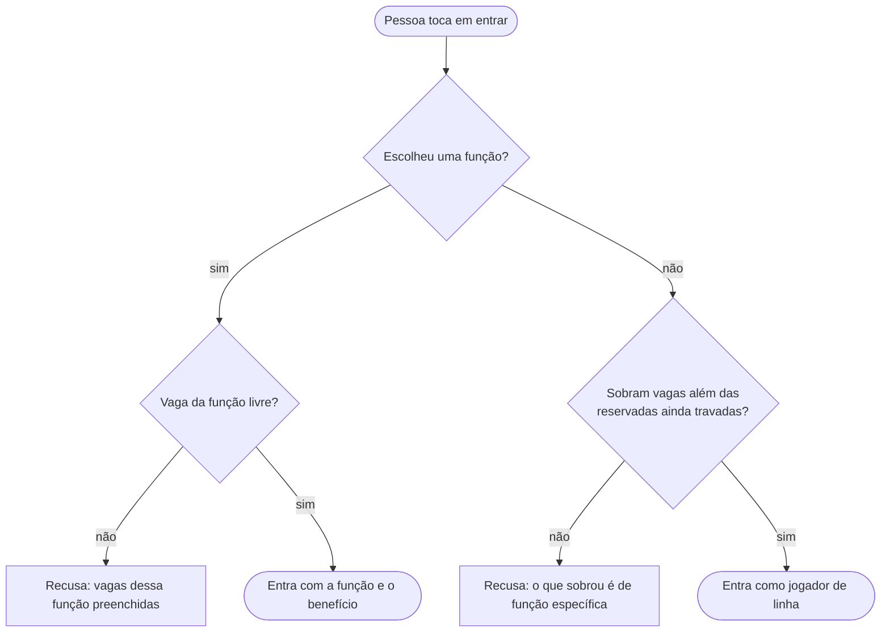
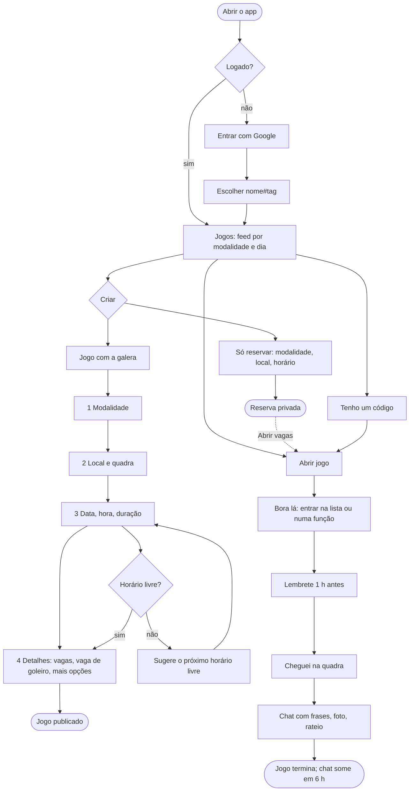
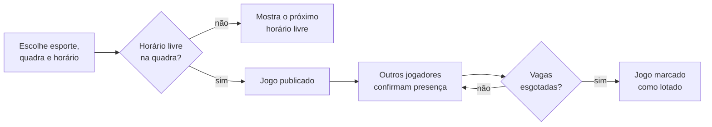
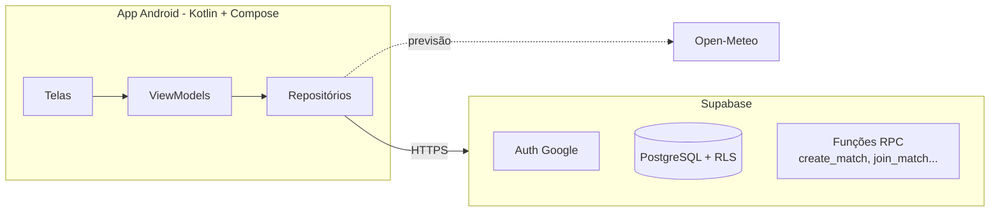
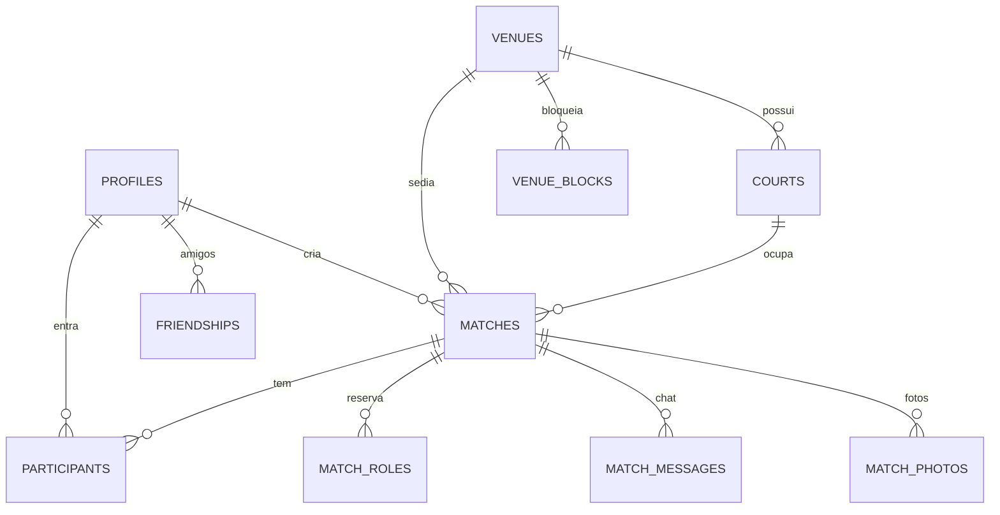

# OurinhosPlay

**Marque o jogo, confirme a galera, sem quadra duplicada.**

OurinhosPlay é um aplicativo Android para organizar jogos esportivos amadores em Ourinhos (SP). Quem só quer a quadra reserva em três toques. Quem quer montar o time abre vagas, reserva goleiro e chama a galera. O app impede que dois jogos ocupem a mesma quadra no mesmo horário.

O objetivo é ser a melhor forma de praticar esporte na cidade: a interface mais cuidada, o fluxo mais curto e nenhuma burocracia.

---

## Sumário

- [O problema](#o-problema)
- [A proposta](#a-proposta)
- [O que o app faz hoje](#o-que-o-app-faz-hoje)
- [Fluxos](#fluxos)
- [Design](#design)
- [Arquitetura](#arquitetura)
- [Modelo de dados e regras de negócio](#modelo-de-dados-e-regras-de-negócio)
- [Segurança](#segurança)
- [Estado atual](#estado-atual)
- [Roadmap](#roadmap)
- [Como o projeto pode gerar receita](#como-o-projeto-pode-gerar-receita)
- [Decisões de produto](#decisões-de-produto)
- [Rodando o projeto](#rodando-o-projeto)
- [Estrutura do código](#estrutura-do-código)
- [Tecnologia](#tecnologia)
- [Documentação](#documentação)

---

## O problema

Hoje, montar uma pelada na cidade depende de grupos de WhatsApp: ninguém sabe quem confirmou, o time fecha incompleto na véspera, ninguém quer ir de goleiro, e dois grupos chegam à mesma quadra pública na mesma hora. Não existe um lugar único onde se veja quais jogos estão abertos nem quais quadras estão livres.

## A proposta

O mesmo app atende três perfis, sem forçar ninguém a passar pelo fluxo do outro.

| Quem só quer a quadra | Quem monta o jogo | Quem cuida das quadras |
|---|---|---|
| **Só reservar**: modalidade, local e horário. A reserva é privada, sem lista, chat nem rateio. Abre na última quadra usada. | **Jogo com a galera**: vagas, vaga reservada de goleiro, rateio com Pix, nível, repetição semanal e código de convite. | Painel admin: cadastra quadras e preços, vê a agenda, bloqueia horários e cria eventos. |

Quatro ideias sustentam o produto:

1. **Agenda única por quadra.** O app mantém a própria agenda. Quem reserva primeiro, dentro do app, leva o horário.
2. **Regra no banco, não na tela.** O anti-choque é uma restrição `EXCLUDE USING gist` do PostgreSQL. Mesmo que dois usuários toquem em "publicar" no mesmo segundo, só um passa. A reserva de vaga por função também é checada no servidor.
3. **Fricção mínima.** Entrar com a conta Google, escolher um nome e jogar. Sem cadastro longo, sem SMS, sem custo de mensagens. Tudo que é opcional fica recolhido e tem padrão inteligente.
4. **Resolver a dor real da pelada.** A função que costuma faltar (goleiro) ganha vaga garantida e benefício, em vez de virar mensagem no grupo.

Cada jogador tem um nome de exibição seguido de uma tag numérica atribuída pelo servidor, no formato `Nome#0042`. Dois jogadores podem se chamar "João" sem ambiguidade, e o nome não muda depois de definido.

---

## O que o app faz hoje

### Criar e reservar

| Recurso | Como funciona |
|---|---|
| **Duas portas de entrada** | O botão **Criar** abre "Só reservar" ou "Jogo com a galera". |
| **Só reservar** | Escolhe modalidade, local e horário e pronto. Cria um jogo privado de 1 vaga, que só bloqueia a quadra. Lembra a última quadra usada. "Abrir vagas" na tela do jogo o transforma em jogo social. |
| **Jogo com a galera** | Quatro passos: modalidade, onde, quando e detalhes. Nível, rateio, jogo só com código e repetição ficam em "Mais opções". |
| **Anti-choque** | Se o horário está ocupado ou bloqueado, o app mostra o motivo e sugere o próximo horário livre. |
| **Duração livre** | Atalhos de 1h, 1h30 e 2h. "Outro" ajusta de 15 em 15 minutos (e de 1 em 1 hora), de 30 minutos a 6 horas. O horário de término aparece sempre, com aviso de "dia seguinte". |
| **Repetição semanal** | Cria um jogo por semana por 4, 8 ou 12 semanas. Se um deles bater em outro horário, avisa quantos foram criados. |
| **Jogar de novo** | Copia quadra, modalidade, título e vagas de um jogo anterior. |
| **14 modalidades** | Futebol, futevôlei, vôlei, basquete, beach tennis, futsal, tênis, tênis de mesa, padel, natação, biribol, corrida, ciclismo e caminhada. |

### Vagas por função

Cada modalidade pode ter **uma função rara** que costuma faltar: goleiro (futebol e futsal) e levantador (vôlei). As demais seguem com vaga única.

- O criador define quantas vagas dessa função e se ficam **reservadas**: ninguém ocupa essa vaga entrando sem função.
- Quem joga na função recebe um **benefício no rateio**: isento, metade ou nada (o criador escolhe; padrão isento). O cálculo do rateio na tela do jogo já desconta.
- Se a vaga reservada ficar vazia, ela **libera para todos** entre 1 hora e 1 dia antes do jogo (padrão 3 horas).
- O feed mostra **"Falta goleiro"** nos jogos com a função aberta. A tela do jogo mostra o painel "Vagas por função" e quem entrou em cada uma.



### Jogar

| Recurso | Como funciona |
|---|---|
| **Feed** | Jogos futuros e abertos, agrupados por dia, com filtro por modalidade e por dia (hoje, amanhã, fim de semana). Eventos em destaque no topo. |
| **Entrar e sair** | "Bora lá" com um toque, com vibração, apito e confete. Controle de lotação no servidor. |
| **Jogo por código** | Jogo "só com código" não aparece no feed; entra quem tem o código de 6 caracteres. |
| **Cheguei na quadra** | Libera 1 hora antes. Avisa a galera e vira um sinal de presença na lista. |
| **Lembrete e cronômetro** | Notificação 1 hora antes e cronômetro "Começa em 01:23:31" na tela do jogo. |
| **Previsão do tempo** | Temperatura e chance de chuva no horário do jogo (Open-Meteo). |
| **Chat do jogo** | Frases prontas e uma foto por pessoa. Tudo some 6 horas depois do jogo. |
| **Rateio com Pix** | O criador informa o valor da quadra e a chave Pix. Só quem entra no jogo vê a chave. O valor por pessoa cai conforme o time enche. |
| **Nível e "procurando"** | Novato, médio ou craque, e um texto livre do que falta. |
| **Compartilhar** | Mensagem pronta para chamar a galera pelo WhatsApp. |
| **Amigos** | Adiciona por nome e número; amigos aparecem com estrela nos jogos. |
| **Perfil** | Jogos feitos, jogos organizados e esporte favorito. Sons do app com chave para silenciar. |

### Organizar e administrar

| Recurso | Como funciona |
|---|---|
| **Meus jogos (Agenda)** | Jogos que criei ou em que estou, futuros e passados, com "jogar de novo". |
| **Editar, cancelar e excluir** | O organizador edita título, descrição e vagas, cancela ou exclui. |
| **Painel admin** | Cadastro de quadras (gratuitas ou pagas, preço por hora, público), bloqueio de horários, eventos com largada e chegada no Maps, destaque de eventos, lista de pessoas e remoção de contas. |
| **Locais reais** | Quadras e espaços de Ourinhos, públicos e particulares, com mais de uma quadra por local. |

---

## Fluxos

### Fluxo do app



### Do horário livre ao jogo lotado



---

## Design

A referência é a Apple: poucas cores, hierarquia clara e acabamento. O app é escuro, e a interface se apoia em quatro decisões.

1. **Conteúdo em superfícies sólidas e neutras.** Cartões translúcidos sobre fundo colorido perdiam contraste ao ar livre e deixavam o app com cara de vários temas ao mesmo tempo.
2. **Vidro só na barra principal**, como no Liquid Glass da Apple: a barra de abas da tela inicial, com blur real do que rola por trás. Em aparelhos sem suporte a blur, cai para um fundo quase opaco. Nas telas internas (jogo, criar) a barra de ação é sólida.
3. **Uma cor de ação.** Laranja-pista é a única cor de ação. A cor do esporte aparece só em sinais pequenos: selo do ícone, barra de vagas e o nome da modalidade.
4. **O horário é o placar.** Numerais condensados em itálico e em branco são a única assinatura ousada do app. O resto é quieto. A foto já diz qual é o esporte, então a cor dele não precisa repetir a informação em tudo.

| Elemento | Valor |
|---|---|
| Fundo | Azul-noite sólido `#0A0E1F`, sem degradê nem cor atrás do conteúdo |
| Superfície | `#121833`, com fio de luz de 9% de branco |
| Texto | `#F4F6FB` principal, `#98A1C4` secundário |
| Ação | Laranja-pista `#FF5B1F` |
| Destaque raro | Verde-limão `#E6FF3D` (ao vivo, "Falta goleiro") |
| Tipografia | Barlow: semibold nos títulos, sem itálico; condensado itálico só na marca e nos horários |
| Fotos das modalidades | Uma foto por esporte (14 no total, cerca de 1 MB). No feed, miniatura quadrada com o selo do esporte; no jogo, capa com degradê escuro e o título por cima; ao criar, cartões de foto para escolher a modalidade. Créditos em [docs/CREDITOS-FOTOS.md](docs/CREDITOS-FOTOS.md) |
| Arte antiga | A ilustração vetorial de quadra e bola foi removida por parecer forçada; sobra só na tela vazia e na galeria de desenvolvimento |

Decisões e motivos em [docs/FUNCOES-E-PARCEIROS.md](docs/FUNCOES-E-PARCEIROS.md).

---

## Arquitetura



O app não tem servidor próprio. Toda regra que não pode ser burlada (anti-choque, lotação, reserva de função, papéis) roda no PostgreSQL, por funções chamadas via RPC e por políticas de Row Level Security.

---

## Modelo de dados e regras de negócio



| Tabela | Papel |
|---|---|
| `profiles` | Nome, tag numérica e papel (o papel `admin` libera o painel) |
| `venues` e `courts` | Locais e as quadras de cada um, com modalidades, preço por hora e público |
| `matches` | Jogos: horário, duração, vagas, rateio, nível, privado, código curto, evento |
| `participants` | Quem está no jogo, a função escolhida e a hora de chegada |
| `match_roles` | Vagas por função: quantidade, reservada, horas para liberar e benefício (0, 50 ou 100%) |
| `venue_blocks` | Horários bloqueados pela administração |
| `match_messages` e `match_photos` | Chat e fotos, que expiram |
| `friendships` | Amizades |

### Regras que valem para qualquer cliente

- **Anti-choque:** restrição `EXCLUDE USING gist` sobre o par quadra e intervalo de tempo em `matches`, com `tstzrange`.
- **Lotação:** `join_match` trava o jogo (`for update`), então duas pessoas pegando a última vaga entram em fila, não em corrida.
- **Reserva de função:** o servidor soma as vagas reservadas ainda vazias e recusa quem entra sem função se só sobrarem elas. A soma das vagas por função não pode passar do total do jogo.
- **Duração:** de 30 minutos a 6 horas, em múltiplos de 15.
- **Escrita por RPC:** criar, entrar, sair, editar, cancelar, excluir, abrir vagas e check-in passam por funções do servidor. Operações administrativas conferem `is_admin()`.

### Funções do servidor

| Função | O que faz |
|---|---|
| `create_match` | Cria o jogo e suas funções, valida horário, quadra, duração e bloqueios |
| `join_match(jogo, função)` | Entra com ou sem função |
| `leave_match` | Sai do jogo (hoje o organizador também pode sair; vale decidir se isso deve continuar assim) |
| `update_match`, `cancel_match`, `delete_match` | Gestão do jogo |
| `open_reservation` | Transforma a reserva rápida em jogo aberto |
| `match_roles_status` | Situação de cada função: ocupadas, travada, quando libera |
| `venue_availability` | Diz se o horário está livre e sugere o próximo |
| `find_match_by_code` | Acha um jogo pelo código curto |
| `check_in` | Marca "Cheguei na quadra" |
| `send_phrase`, `send_photo` | Chat; `purge_expired_chat` limpa o que expirou |
| `add_friend`, `remove_friend`, `my_friends` | Amigos |
| `admin_*` | Quadras, bloqueios, eventos, destaque, pessoas |

### Migrações

Dezesseis arquivos versionados em [supabase/migrations](supabase/migrations), aplicados em ordem.

| Arquivo | O que faz |
|---|---|
| `0001_profiles` | Perfis, tag numérica e nome |
| `0002_venues_matches` | Locais, jogos e participantes |
| `0003_create_match` | Criar jogo, bloqueios e disponibilidade |
| `0004_join_leave` | Entrar e sair com controle de lotação |
| `0005_manage_match` | Editar, cancelar e excluir |
| `0006_locais_ourinhos` | Locais reais de Ourinhos |
| `0007_locais_demais_modalidades` | Locais das demais modalidades |
| `0008_jogos_de_teste_OPCIONAL` | Jogos de exemplo (pode pular) |
| `0009_courts_admin` | Quadras e operações do admin |
| `0010_esportes_eventos` | Novas modalidades e eventos |
| `0011_admin_usuarios` | Lista e remoção de contas |
| `0012_social` | Cheguei, chat, fotos e amigos |
| `0013_futevolei` | Futevôlei |
| `0014_organizacao` | Rateio com Pix, jogo só com código, nível, "procurando", código curto, tênis de mesa |
| `0015_funcoes` | Vagas por função, reserva, benefício e abrir vagas |
| `0016_duracao_livre` | Duração de 30 minutos a 6 horas |

---

## Segurança

- O app carrega apenas a chave pública do Supabase. A proteção real vem das políticas de Row Level Security.
- Escrita em `profiles` só acontece por função do servidor; o cliente não consegue alterar o próprio papel nem trocar o nome depois de definido.
- O papel `admin` só é concedido direto no banco, nunca pelo cliente; as telas administrativas dependem de RPCs que validam o papel.
- A chave Pix só aparece para quem organiza ou está na lista do jogo.
- Chaves e IDs ficam em `secrets.properties`, fora do controle de versão.

---

## Estado atual

O projeto está em desenvolvimento ativo, em fase de validação em emulador e em aparelho real.

| Etapa | Entrega | Situação |
|---|---|---|
| 0 | Ambiente, build e pipeline de instalação | Concluída |
| 1 | Login com Google, perfil com nome e tag, sessão persistente | Concluída |
| 2 | Navegação, feed de jogos com filtro por esporte, lista de quadras | Concluída |
| 3 | Criar jogo com validação de choque de horário | Concluída |
| 4 | Detalhe do jogo, confirmar e sair, efeitos sonoros e visuais | Concluída |
| 5 | Meus jogos, jogar de novo, compartilhar, editar e cancelar | Concluída |
| 6 | Painel administrativo: quadras, preços e bloqueio de horários | Concluída |
| 7 | Acessibilidade e acabamento | Em andamento |
| 8 | Reserva rápida, vagas por função, duração livre e novo design | Implementada; falta validar com duas contas |

**Pendências de validação**

- Entrar numa vaga de função com uma segunda conta (o organizador entra como jogador de linha).
- Fluxo completo de "Só reservar" e "Abrir vagas".
- Verificação com TalkBack e em celular físico de entrada.
- Desempenho do blur em aparelhos simples.
- Distribuição pela Play Store.

O detalhamento de telas, fluxos e modelo de dados está em [docs/PRD.md](docs/PRD.md).

---

## Roadmap

Legenda: **Pronto**, **Próximo** (já desenhado, é a fila de trabalho), **Depois** (valor claro, ainda sem desenho), **Ideia** (a validar). O passo a passo de execução, com ordem e esforço, está em [docs/COMO-CHEGAR-LA.md](docs/COMO-CHEGAR-LA.md).

### Pronto

| Área | Entrega |
|---|---|
| Base | Login, perfil, feed, criar jogo com anti-choque, entrar e sair |
| Social | Cheguei, chat com frases e foto, amigos, estatísticas leves |
| Organização | Recorrência, rateio com Pix, jogo por código, nível, lembrete |
| Admin | Jogos, eventos, quadras e preços, bloqueios, pessoas |
| Funções | Vaga reservada por função, benefício no rateio, liberação automática, "Falta goleiro" |
| Reserva | Só reservar, última quadra lembrada, abrir vagas depois, duração livre |
| Design | Tema azul-noite sólido, cartões sólidos, vidro nas barras flutuantes, horário como placar, fotos por modalidade |

### Próximo: completar o jogo

| Item | O que entrega | Depende de |
|---|---|---|
| **Lista de espera por função** | Se o jogo ou a função está cheia, a pessoa entra na fila. Quando alguém sai, o primeiro da fila daquela função é promovido automaticamente e avisado. | Banco (tabela de fila e promoção em `leave_match`); idealmente push |
| **Sorteio de times** | Botão do organizador: divide a lista em times equilibrados por nível e por função (um goleiro por time) e deixa compartilhar o resultado. | Nível por jogador no perfil |
| **"Posso jogar de..."** | Funções preferidas no perfil (goleiro, levantador). Quem marcou é avisado quando abrir vaga dessa função. | Push |
| **Notificações push** | Vaga aberta, cancelamento, promoção da lista de espera, amigo entrou e lembretes, com preferências por tipo. | Firebase Cloud Messaging |
| **Convite por link** | Link que abre o jogo direto no app, ou leva à instalação. | App Links e página de convite |
| **Editar o jogo por inteiro** | Hoje edita título, descrição e vagas. Passa a editar horário, duração, funções e rateio, avisando quem já entrou. | Revalidar anti-choque no servidor |
| **Opção "reduzir transparência"** | Troca o vidro da barra principal por fundo sólido, para quem precisa de mais contraste ou tem aparelho simples. | Nada |
| **Equipamento por jogo, com interruptores** | Na criação: "Precisa de bola?", "Colete?", "Rede?" (sim ou não, conforme o esporte) e quem leva. Aparece no jogo como lista de itens que alguém pode assumir com um toque ("eu levo"). Hoje só existe a frase pronta "Quem leva a bola?" no chat. | Colunas novas em `matches` |
| **Regras do jogo, também em interruptores** | Misto ou não, aceita iniciante, tipo de calçado (chuteira, tênis), levar água. Quanto mais personalizável o jogo, menos ele depende de combinar no WhatsApp. | Nada |
| **Primeiros passos** | Três telas rápidas na primeira abertura: o que o app faz, escolher esportes favoritos e permitir notificações. | Nada |
| **Carregamento e telas vazias** | Esqueletos no lugar do círculo girando, e telas vazias que mostram o próximo passo. | Nada |
| **Foto do perfil** | Avatar com foto, no lugar da inicial, na lista do jogo e nos amigos. | Armazenamento de arquivos |

### Depois: reputação, comunidade e descoberta

| Item | O que entrega |
|---|---|
| **Selo de presença confiável** | Reconhece quem aparece e avisa quando cancela. Só reforço positivo, sem ranking de piores. |
| **Avaliação pós-jogo** | Jogo limpo e pontualidade, privadas, que alimentam o selo. |
| **Check-in por proximidade** | "Cheguei" confirmado pela localização perto da quadra. |
| **Mural de fotos do jogo** | Fotos que somem em 7 dias. |
| **Meu time e mensalistas** | Grupo fixo que repete toda semana, com lista própria e reposição de quem falta. |
| **Mais funções por modalidade** | Funções configuráveis além da rara (por exemplo, armador e pivô no basquete). |
| **Mapa de quadras** | Mapa com as quadras, filtros por distância, preço e disponibilidade. |
| **Placar privado e torneio privado** | Placar e gols por jogo, só para quem jogou, e modo torneio entre amigos. |
| **Gamificação amigável** | Sequência de jogos e conquistas, sem ranking de piores. |
| **Aulas e escolinhas** | Aulas dos locais municipais, com vagas e horários. |
| **Fotos próprias dos locais** | Trocar as fotos genéricas por registros das quadras reais de Ourinhos, com autorização, e tirar as que mostram marcas. |
| **Mais cidades** | Cadastro de locais por cidade e escolha da cidade no app. |

### Parceiros: monetizar por serviços em cima do app

O app é gratuito para o jogador e para a quadra. A receita vem de serviços ligados ao uso real da quadra. Nesta fase tudo é **protótipo** para mostrar a parceiros; ainda não há integração.

| Item | O que entrega | Atrito |
|---|---|---|
| **Cupom de consumo local** | Jogo confirmado e "Cheguei" geram um código. O grupo ganha desconto na quadra ou na lanchonete parceira; o parceiro valida o código. | Baixo |
| **Torneio com premiação patrocinada** | Inscrição por equipe; o comércio local banca a premiação em troca de marca. | Médio |
| **Horário ocioso negociável** | A quadra define um preço-piso nos horários vazios; o grupo faz uma oferta e o dono aceita ou contra-propõe. Grupo completo no app vale desconto. | Médio |
| **Serviços no jogo** | Árbitro, bola, colete, hidratação, fotógrafo, churrasco pós-jogo. | Médio |
| **Passe de benefícios** | Assinatura barata do jogador com descontos nos parceiros. | Alto (precisa de massa crítica) |
| **Portal do parceiro** | Cadastrar oferta, validar código e ver relatório. Pré-requisito de todos os itens acima. | Médio |

Análise completa, riscos e ordem sugerida em [docs/FUNCOES-E-PARCEIROS.md](docs/FUNCOES-E-PARCEIROS.md).

### Atleta: por último

Modo para quem treina por conta própria (corrida, ciclismo, caminhada): metas, histórico de treinos, evolução e, mais adiante, rastreio por GPS. Fica por último, depois de a parte de jogos estar sólida.

### O que falta para mostrar a investidores e abrir um beta público

Um app de jogos amadores precisa de gente usando todo dia para parecer vivo. Esta lista é o que separa o protótipo de algo que se apresenta com confiança.

| Frente | Já tem | Falta |
|---|---|---|
| **Produto** | Criar, reservar, entrar, funções, rateio, admin | Lista de espera, sorteio de times, equipamento e regras em interruptores |
| **Primeira impressão** | Visual sólido, fotos, horário como placar | Primeiros passos, carregamento com esqueletos, transições entre telas, fotos próprias dos locais |
| **Retenção** | Lembrete antes do jogo | Notificações push, convite por link, selo de presença |
| **Confiança** | Regras no banco, RLS | Testes automatizados, relatório de falhas, revisão com TalkBack, política de privacidade |
| **Distribuição** | APK de teste | Play Store, OAuth próprio, ícone e ficha da loja |
| **Negócio** | Análise de modelos | Dois ou três parceiros reais, portal do parceiro, métricas de uso (jogos criados, taxa de lotação, retorno em 7 dias) |
| **Dados** | Locais reais cadastrados | Retirar os jogos de teste, que mostram títulos fora de lugar |

### Plataforma e lançamento

| Item | O que entrega |
|---|---|
| **Play Store** | Versão assinada de release, ficha da loja e política de privacidade. |
| **Excluir a própria conta** | Hoje só o admin remove contas; o Google exige que o próprio usuário consiga excluir a dele dentro do app. |
| **Cliente OAuth próprio** | Login Google com credenciais de produção. |
| **Testes automatizados** | Testes dos ViewModels e das regras, e testes das funções SQL (anti-choque, lotação, reserva de função). |
| **Integração contínua** | Build e testes a cada alteração. |
| **Monitoramento** | Relatório de falhas e métricas de uso. |
| **Acessibilidade** | Verificação com TalkBack e ajuste de contraste e tamanhos de fonte. |
| **iOS** | Versão para iPhone, seguindo o plano de [docs/IOS-HANDOFF.md](docs/IOS-HANDOFF.md). |

---

## Como o projeto pode gerar receita

Resumo; o detalhe está em [docs/FUNCOES-E-PARCEIROS.md](docs/FUNCOES-E-PARCEIROS.md).

- **Sem assinatura do jogador e sem cobrança de quadra pelo app** no começo. Crescer primeiro.
- **Receita por serviços:** cupom de consumo (valor fixo por resgate), torneios patrocinados, horário ocioso e serviços no jogo.
- **Ordem sugerida:** cupom de consumo, depois torneio patrocinado, depois horário ocioso negociável.
- **Cuidados:** comissão sem caixa integrado é difícil de medir, então começar com valor fixo por resgate; evitar segurar dinheiro (o Pix vai direto ao dono); sorteio ou rifa exige autorização, então evitar; competição por habilidade é tranquila.

---

## Decisões de produto

- Um local pode ter **várias quadras**, gratuitas ou pagas, com preço e público.
- **Equipamento por jogo** (bola, rede) é um campo opcional, conforme o esporte.
- **Gamificação amigável**: nunca ranking de piores.
- **Dia do jogo:** contagem regressiva e notificação com cronômetro; check-in "Cheguei" na quadra.
- **Sem burocracia:** quem só quer reservar não vê vagas, funções, nível nem rateio.
- **Sem dados que o jogo não precisa:** o chat expira, as fotos somem e a chave Pix só aparece para quem está no jogo.

---

## Rodando o projeto

Pré-requisitos: Windows 10 ou 11, JDK 17 e Android SDK 35. O passo a passo de instalação está em [docs/SETUP-WINDOWS.md](docs/SETUP-WINDOWS.md).

**1. Configurar as chaves**

```powershell
Copy-Item secrets.properties.example secrets.properties
```

Preencha `SUPABASE_URL`, `SUPABASE_ANON_KEY` e `GOOGLE_WEB_CLIENT_ID`. Os valores do Supabase estão em Project Settings, API.

**2. Criar as tabelas**

No painel do Supabase, abra o SQL Editor e execute, em ordem, os arquivos de [supabase/migrations](supabase/migrations) de `0001` a `0007`, depois `0009` a `0016`. O `0008_jogos_de_teste_OPCIONAL.sql` só insere jogos de exemplo e pode ser pulado. Cada arquivo pode ser executado mais de uma vez sem problema, e cada um depende dos anteriores.

**3. Rodar no emulador**

```powershell
.\scripts\emulador.ps1    # cria e inicia o emulador, aguarda o boot
.\scripts\deploy.ps1      # compila, instala e abre o app
```

Para usar um celular físico em vez do emulador, siga [docs/DEPLOY-CELULAR.md](docs/DEPLOY-CELULAR.md). O mesmo `deploy.ps1` funciona nos dois casos.

**4. Gerar o APK para amigos testarem**

```powershell
.\scripts\gerar-apk.ps1   # build "beta": sem modo debug, otimizado e encolhido (cerca de 3 MB)
```

O build `beta` mantém o mesmo identificador e a mesma assinatura do debug, então o login Google já registrado funciona.

### Versões do app e do banco

O app tolera um banco desatualizado em alguns pontos (por exemplo, esconde jogos privados se faltar a migração `0014` e ignora funções se faltar a `0015`), mas **publicar jogo com vaga de goleiro exige a `0015`** e **duração fora de 1h, 1h30 e 2h exige a `0016`**. Em caso de dúvida, rode todas as migrações em ordem.

---

## Estrutura do código

```
app/src/main/java/com/ourinhosplay/app/
  MainActivity.kt        entrada: splash, sessão e navegação raiz
  auth/                  login com Google e estado de sessão
  data/
    Matches.kt           jogos, locais, quadras, criação e detalhe
    Roles.kt             funções por vaga, benefício e reserva
    Social.kt            Cheguei, chat, fotos e amigos
    Profile.kt           perfil
    Supabase.kt          cliente do Supabase
  ui/
    Theme.kt             paleta, tipografia e formas
    Glass.kt             fundo, cartão sólido e barra de vidro com blur
    Components.kt        cartão do jogo, ícone do esporte, barra de vagas
    HomeShell.kt         abas, feed, agenda, locais e barra flutuante
    QuickReserve.kt      tela de entrada do "Criar" e "Só reservar"
    CreateMatch.kt       "Jogo com a galera": seletores, duração e funções
    MatchDetail.kt       cabeçalho, painel de funções, barra de ação
    MatchExtras.kt       clima, rateio e organização do jogo
    AdminScreen.kt       painel administrativo
    Profile.kt           perfil e amigos
    SportArt.kt          arte vetorial antiga (tela vazia e galeria de desenvolvimento)
    GameFx.kt, Sfx.kt    confete, vibração e sons
app/src/main/res/
  drawable-nodpi/        fotos das 14 modalidades (sport_*.jpg)
supabase/
  migrations/            SQL versionado do banco
docs/                    produto, ambiente, deploy, iOS e desenho das funções
scripts/                 emulador, instalação e APK
```

---

## Tecnologia

| Camada | Escolha | Motivo |
|---|---|---|
| Aplicativo | Kotlin, Jetpack Compose, Material 3 | Interface nativa Android, declarativa e acessível |
| Vidro | Haze 1.3 | Blur real do conteúdo atrás das barras flutuantes |
| Autenticação | Supabase Auth, Credential Manager, Google Sign-In | Um toque, sem custo por SMS |
| Banco de dados | PostgreSQL via Supabase, com Row Level Security | Regras de acesso, anti-choque e reserva de função aplicadas no servidor |
| Comunicação | supabase-kt (Auth, Postgrest), Ktor | Cliente da comunidade para Kotlin |
| Previsão do tempo | Open-Meteo | Sem chave de acesso |
| Build | Gradle 8.9, AGP 8.7, Kotlin 2.0 | Versões fixadas por catálogo em `gradle/libs.versions.toml` |
| Alvo | Android 8.0 ou superior (API 26), compilado para API 35 | Cobre a grande maioria dos aparelhos em uso |

---

## Documentação

| Documento | Conteúdo |
|---|---|
| [PRD](docs/PRD.md) | Produto, telas, fluxos, modelo de dados e roadmap |
| [Funções e parceiros](docs/FUNCOES-E-PARCEIROS.md) | Reserva rápida, vagas por função, duração livre, decisões de design e análise de monetização |
| [Ambiente Windows](docs/SETUP-WINDOWS.md) | Instalação e verificação das ferramentas |
| [Emulador no PC](docs/EMULADOR-PC.md) | Rodar sem celular |
| [Celular físico](docs/DEPLOY-CELULAR.md) | Instalar o APK direto no aparelho |
| [Como chegar lá](docs/COMO-CHEGAR-LA.md) | Passo a passo dos itens que faltam: primeiros passos, métricas, push, convite por link e Play Store |
| [Créditos das fotos](docs/CREDITOS-FOTOS.md) | Origem e licença das fotos, e o que revisar antes da Play Store |
| [Handoff iOS](docs/IOS-HANDOFF.md) | Plano para a versão iPhone, ainda não iniciada |

## Licença

Projeto privado, todos os direitos reservados.
