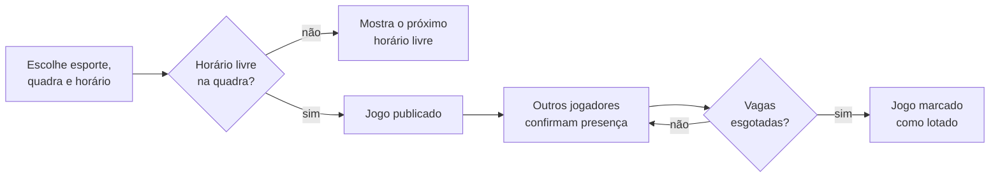

# OurinhosPlay

**Marque o jogo, confirme a galera, sem quadra duplicada.**

OurinhosPlay é um aplicativo Android para organizar jogos esportivos amadores em Ourinhos (SP). Qualquer pessoa cria uma partida, escolhe a quadra e o horário, e os outros jogadores confirmam presença com um toque. O app impede que dois jogos ocupem a mesma quadra no mesmo horário.

---

## O problema

Hoje, montar uma pelada na cidade depende de grupos de WhatsApp: ninguém sabe quem confirmou, o time fecha incompleto na véspera, e dois grupos chegam à mesma quadra pública na mesma hora. Não existe um lugar único onde se veja quais jogos estão abertos nem quais quadras estão livres.

## A proposta

| Para quem joga | Para quem organiza | Para quem cuida das quadras |
|---|---|---|
| Ver jogos abertos por esporte, ver quem vai, entrar com um toque | Criar o jogo em poucos passos e acompanhar a lista de confirmados | Ter a agenda de cada quadra visível e poder bloquear horários |

Três ideias sustentam o produto:

1. **Agenda única por quadra.** O app mantém a própria agenda. Quem reserva primeiro, dentro do app, leva o horário.
2. **Regra no banco, não na tela.** O anti-choque é uma restrição do PostgreSQL. Mesmo que dois usuários toquem em "publicar" no mesmo segundo, só um passa.
3. **Fricção mínima.** Entrar com a conta Google, escolher um nome e jogar. Sem cadastro longo, sem SMS, sem custo de mensagens.

## Como funciona



Cada jogador tem um nome de exibição seguido de uma tag numérica atribuída pelo servidor, no formato `Nome#0042`. Dois jogadores podem se chamar "João" sem ambiguidade, e o nome não muda depois de definido.

## Estado atual

O projeto está no início. O que existe e o que vem a seguir:

| Etapa | Entrega | Situação |
|---|---|---|
| 0 | Ambiente, build e pipeline de instalação | Concluída |
| 1 | Login com Google, perfil com nome e tag, sessão persistente | Implementada, em validação |
| 2 | Cadastro de quadras, feed de jogos com filtro por esporte, navegação | Planejada |
| 3 | Criar jogo com validação de choque de horário | Planejada |
| 4 | Detalhe do jogo, confirmar e sair, feedback tátil e sonoro | Planejada |
| 5 | Meus jogos, revanche, compartilhar | Planejada |
| 6 | Painel administrativo e bloqueio de horários | Planejada |
| 7 | Acessibilidade, notificações, acabamento | Planejada |

O detalhamento completo de telas, fluxos e modelo de dados está em [docs/PRD.md](docs/PRD.md).

## Tecnologia

| Camada | Escolha | Motivo |
|---|---|---|
| Aplicativo | Kotlin, Jetpack Compose, Material 3 | Interface nativa Android, declarativa e acessível |
| Autenticação | Supabase Auth, Credential Manager, Google Sign-In | Um toque, sem custo por SMS |
| Banco de dados | PostgreSQL via Supabase, com Row Level Security | Regras de acesso e anti-choque aplicadas no servidor |
| Comunicação | supabase-kt (Auth, Postgrest), Ktor | Cliente oficial da comunidade para Kotlin |
| Build | Gradle 8.9, AGP 8.7, Kotlin 2.0 | Versões fixadas por catálogo em `gradle/libs.versions.toml` |
| Alvo | Android 8.0 ou superior (API 26), compilado para API 35 | Cobre a grande maioria dos aparelhos em uso |

O iOS está previsto para uma fase futura e o plano de retomada está em [docs/IOS-HANDOFF.md](docs/IOS-HANDOFF.md). Todo o backend é reaproveitado; só a interface é reescrita.

## Segurança em poucas linhas

- O app carrega apenas a chave pública do Supabase. A proteção real vem das políticas de Row Level Security.
- Escrita em `profiles` só acontece por função do servidor; o cliente não consegue alterar o próprio papel nem trocar o nome depois de definido.
- Chaves e IDs ficam em `secrets.properties`, fora do controle de versão.

## Rodando o projeto

Pré-requisitos: Windows 10 ou 11, JDK 17 e Android SDK 35. O passo a passo de instalação está em [docs/SETUP-WINDOWS.md](docs/SETUP-WINDOWS.md).

**1. Configurar as chaves**

```powershell
Copy-Item secrets.properties.example secrets.properties
```

Preencha `SUPABASE_URL`, `SUPABASE_ANON_KEY` e `GOOGLE_WEB_CLIENT_ID`. Os valores do Supabase estão em Project Settings, API.

**2. Criar as tabelas**

No painel do Supabase, abra o SQL Editor e execute o conteúdo de [supabase/migrations/0001_profiles.sql](supabase/migrations/0001_profiles.sql).

**3. Rodar no emulador**

```powershell
.\scripts\emulador.ps1    # cria e inicia o emulador, aguarda o boot
.\scripts\deploy.ps1      # compila, instala e abre o app
```

Para usar um celular físico em vez do emulador, siga [docs/DEPLOY-CELULAR.md](docs/DEPLOY-CELULAR.md). O mesmo `deploy.ps1` funciona nos dois casos.

## Estrutura

```
app/src/main/java/com/ourinhosplay/app/
  auth/        login com Google e estado de sessão
  data/        cliente Supabase e repositórios
  ui/          telas e tema (Compose)
supabase/
  migrations/  SQL versionado do banco
docs/          produto, ambiente, deploy e iOS
scripts/       emulador e instalação
```

## Documentação

| Documento | Conteúdo |
|---|---|
| [PRD](docs/PRD.md) | Produto, telas, fluxos, modelo de dados e roadmap |
| [Ambiente Windows](docs/SETUP-WINDOWS.md) | Instalação e verificação das ferramentas |
| [Emulador no PC](docs/EMULADOR-PC.md) | Rodar sem celular |
| [Celular físico](docs/DEPLOY-CELULAR.md) | Instalar o APK direto no aparelho |
| [Handoff iOS](docs/IOS-HANDOFF.md) | Plano para a versão iPhone |

## Licença

Projeto privado, todos os direitos reservados.
