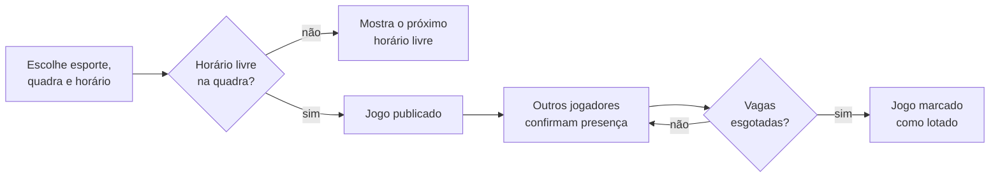
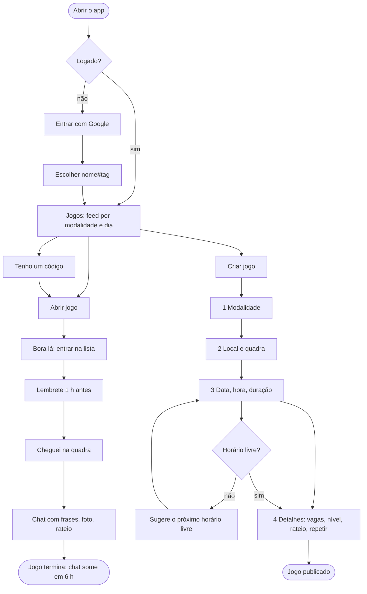
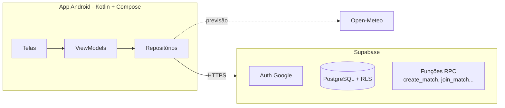
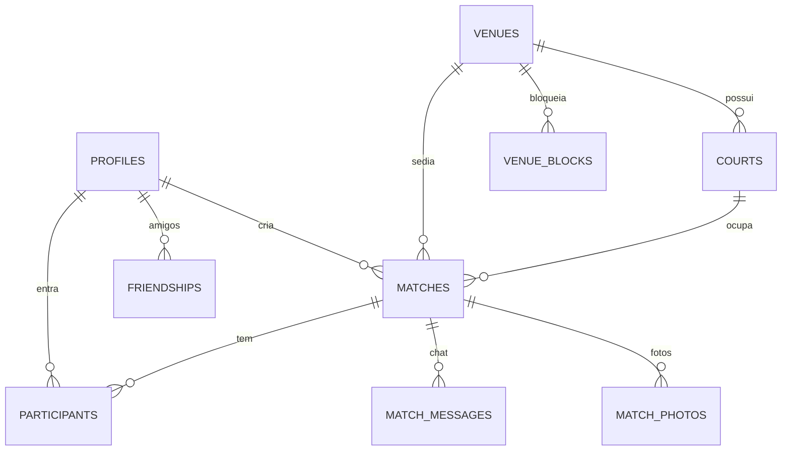

# OurinhosPlay

**Marque o jogo, confirme a galera, sem quadra duplicada.**

OurinhosPlay é um aplicativo Android para organizar jogos esportivos amadores em Ourinhos (SP). Qualquer pessoa cria uma partida, escolhe a quadra e o horário, e os outros jogadores confirmam presença com um toque. O app impede que dois jogos ocupem a mesma quadra no mesmo horário.

---

## O problema

Hoje, montar uma pelada na cidade depende de grupos de WhatsApp: ninguém sabe quem confirmou, o time fecha incompleto na véspera, e dois grupos chegam à mesma quadra pública na mesma hora. Não existe um lugar único onde se veja quais jogos estão abertos nem quais quadras estão livres.

## A proposta

| Para quem joga | Para quem organiza | Para quem cuida das quadras |
|---|---|---|
| Ver jogos abertos por esporte, ver quem vai, entrar com um toque | Criar o jogo em poucos passos, editar, cancelar e jogar de novo | Cadastrar quadras e preços, ver a agenda e bloquear horários |

Três ideias sustentam o produto:

1. **Agenda única por quadra.** O app mantém a própria agenda. Quem reserva primeiro, dentro do app, leva o horário.
2. **Regra no banco, não na tela.** O anti-choque é uma restrição `EXCLUDE USING gist` do PostgreSQL. Mesmo que dois usuários toquem em "publicar" no mesmo segundo, só um passa.
3. **Fricção mínima.** Entrar com a conta Google, escolher um nome e jogar. Sem cadastro longo, sem SMS, sem custo de mensagens.

## Como funciona



Cada jogador tem um nome de exibição seguido de uma tag numérica atribuída pelo servidor, no formato `Nome#0042`. Dois jogadores podem se chamar "João" sem ambiguidade, e o nome não muda depois de definido.

## Estado atual

O projeto está em desenvolvimento ativo, em fase de validação em aparelho real. O que já funciona:

| Etapa | Entrega | Situação |
|---|---|---|
| 0 | Ambiente, build e pipeline de instalação | Concluída |
| 1 | Login com Google, perfil com nome e tag, sessão persistente | Concluída |
| 2 | Navegação, feed de jogos com filtro por esporte, lista de quadras | Concluída |
| 3 | Criar jogo com validação de choque de horário | Concluída |
| 4 | Detalhe do jogo, confirmar e sair, efeitos sonoros e visuais | Concluída |
| 5 | Meus jogos, jogar de novo, compartilhar, editar e cancelar | Concluída |
| 6 | Painel administrativo: quadras, preços e bloqueio de horários | Concluída |
| 7 | Acessibilidade e acabamento | Em andamento |

Também entregues: identidade visual esportiva, splash animada, locais reais de Ourinhos e quadras gratuitas ou pagas com preço por hora. Catorze modalidades (futebol, futevôlei, vôlei, basquete, beach tennis, futsal, tênis, tênis de mesa, padel, natação, biribol, corrida, ciclismo e caminhada) e eventos com largada e chegada no Maps, destacados no topo do feed. Dentro do jogo: "Cheguei na quadra", previsão do tempo, chat com frases prontas e uma foto por pessoa (some 6 horas depois do jogo) e amigos por nome e número. O painel admin lista as pessoas e remove contas.

Ainda não existe: verificação com TalkBack e em celular físico, e distribuição pela Play Store.

O detalhamento completo de telas, fluxos e modelo de dados está em [docs/PRD.md](docs/PRD.md).

## Fluxo do app



## Arquitetura



## Modelo de dados



## Roadmap

| Fase | Itens | Situação |
|---|---|---|
| Base | Login, perfil, feed, criar jogo com anti-choque, entrar e sair | Pronto |
| Social | Cheguei, chat com frases e foto, amigos, estatísticas leves | Pronto |
| Organização | Recorrência, rateio com Pix, jogo por código, nível, lembrete | Pronto |
| Admin | Jogos, eventos, quadras e preços, bloqueios, pessoas | Pronto |
| Próximo | Lista de espera com promoção automática | Ideia |
| Próximo | Sorteio de times equilibrados por nível | Ideia |
| Próximo | Notificações push (vaga aberta, cancelamento, amigo entrou) | Ideia |
| Depois | Convite por link que abre direto no jogo | Ideia |
| Depois | Selo de presença confiável (sem ranking de piores) | Ideia |
| Depois | Check-in por proximidade na quadra | Ideia |
| Depois | Mural de fotos do jogo (some em 7 dias) | Ideia |
| Depois | Aulas e escolinhas dos locais municipais | Ideia |
| Lançamento | Versão assinada para a Play Store e cliente OAuth próprio | Planejado |

## Tecnologia

| Camada | Escolha | Motivo |
|---|---|---|
| Aplicativo | Kotlin, Jetpack Compose, Material 3 | Interface nativa Android, declarativa e acessível |
| Autenticação | Supabase Auth, Credential Manager, Google Sign-In | Um toque, sem custo por SMS |
| Banco de dados | PostgreSQL via Supabase, com Row Level Security | Regras de acesso e anti-choque aplicadas no servidor |
| Comunicação | supabase-kt (Auth, Postgrest), Ktor | Cliente da comunidade para Kotlin |
| Build | Gradle 8.9, AGP 8.7, Kotlin 2.0 | Versões fixadas por catálogo em `gradle/libs.versions.toml` |
| Alvo | Android 8.0 ou superior (API 26), compilado para API 35 | Cobre a grande maioria dos aparelhos em uso |

## Modelo de dados

Seis tabelas no schema `public`, todas com Row Level Security: `profiles`, `venues` (locais), `courts` (quadras de cada local), `matches`, `participants` e `venue_blocks` (horários bloqueados).

- **Anti-choque:** restrição `EXCLUDE USING gist` sobre o par quadra e intervalo de tempo em `matches`, com `tstzrange`. A regra vale para qualquer cliente, não só para o app.
- **Escrita por RPC:** criar, entrar, sair, editar, cancelar e excluir jogo passam por funções do servidor (`create_match`, `join_match`, `leave_match`, `update_match`, `cancel_match`, `delete_match`). Operações administrativas conferem `is_admin()`.
- **Migrações:** catorze arquivos versionados em [supabase/migrations](supabase/migrations), aplicados em ordem.

## Segurança em poucas linhas

- O app carrega apenas a chave pública do Supabase. A proteção real vem das políticas de Row Level Security.
- Escrita em `profiles` só acontece por função do servidor; o cliente não consegue alterar o próprio papel nem trocar o nome depois de definido.
- O papel `admin` só é concedido direto no banco, nunca pelo cliente; as telas administrativas dependem de RPCs que validam o papel.
- Chaves e IDs ficam em `secrets.properties`, fora do controle de versão.

## Rodando o projeto

Pré-requisitos: Windows 10 ou 11, JDK 17 e Android SDK 35. O passo a passo de instalação está em [docs/SETUP-WINDOWS.md](docs/SETUP-WINDOWS.md).

**1. Configurar as chaves**

```powershell
Copy-Item secrets.properties.example secrets.properties
```

Preencha `SUPABASE_URL`, `SUPABASE_ANON_KEY` e `GOOGLE_WEB_CLIENT_ID`. Os valores do Supabase estão em Project Settings, API.

**2. Criar as tabelas**

No painel do Supabase, abra o SQL Editor e execute, em ordem, os arquivos de [supabase/migrations](supabase/migrations) de `0001` a `0007`, depois `0009` a `0014`. O `0008_jogos_de_teste_OPCIONAL.sql` só insere jogos de exemplo e pode ser pulado.

**3. Rodar no emulador**

```powershell
.\scripts\emulador.ps1    # cria e inicia o emulador, aguarda o boot
.\scripts\deploy.ps1      # compila, instala e abre o app
```

Para usar um celular físico em vez do emulador, siga [docs/DEPLOY-CELULAR.md](docs/DEPLOY-CELULAR.md). O mesmo `deploy.ps1` funciona nos dois casos.

## Estrutura

```
app/src/main/java/com/ourinhosplay/app/
  auth/        login com Google e estado de sessão
  data/        cliente Supabase, perfil e partidas
  ui/          telas, componentes, tema e efeitos (Compose)
supabase/
  migrations/  SQL versionado do banco
docs/          produto, ambiente, deploy e iOS
scripts/       emulador e instalação
```

## Documentação

| Documento | Conteúdo |
|---|---|
| [PRD](docs/PRD.md) | Produto, telas, fluxos, modelo de dados e roadmap |
| [Ambiente Windows](docs/SETUP-WINDOWS.md) | Instalação e verificação das ferramentas |
| [Emulador no PC](docs/EMULADOR-PC.md) | Rodar sem celular |
| [Celular físico](docs/DEPLOY-CELULAR.md) | Instalar o APK direto no aparelho |
| [Handoff iOS](docs/IOS-HANDOFF.md) | Plano para a versão iPhone, ainda não iniciada |

## Licença

Projeto privado, todos os direitos reservados.
