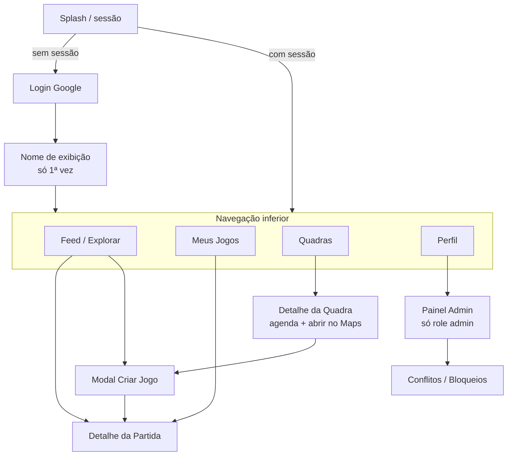
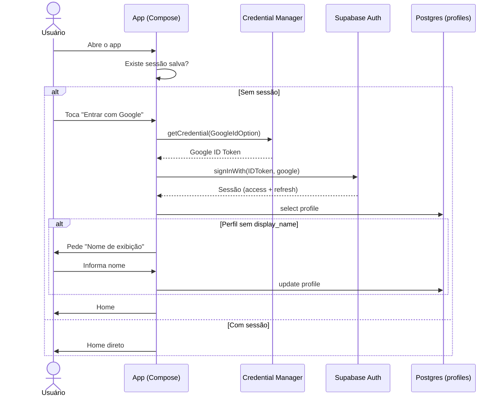
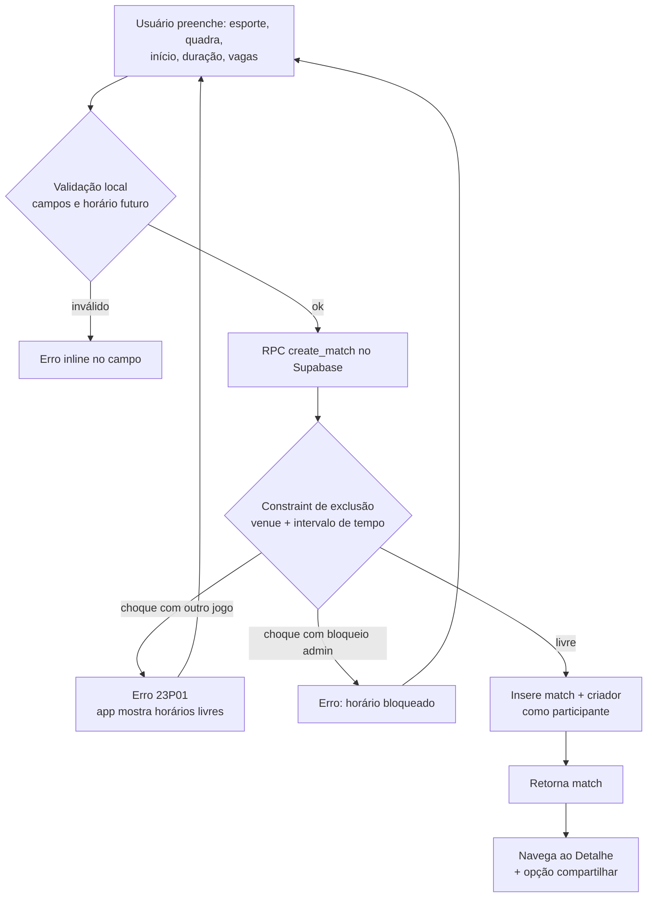
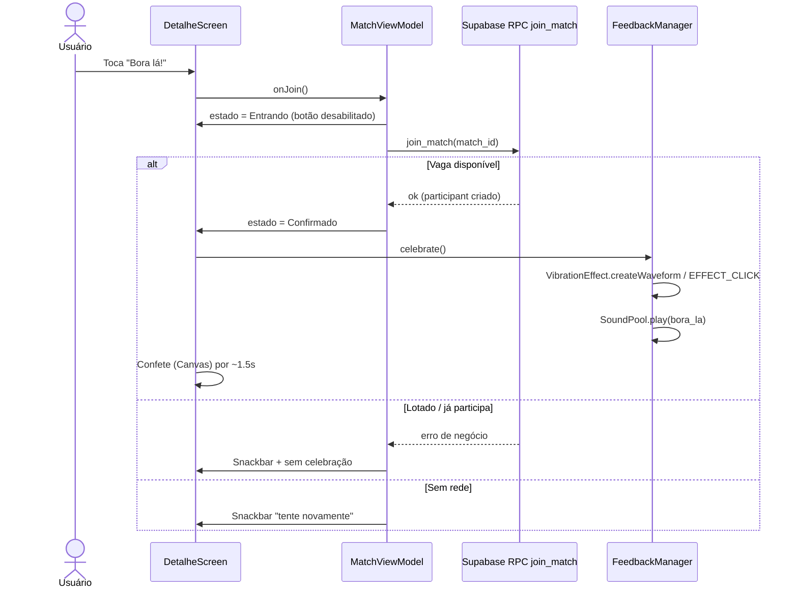
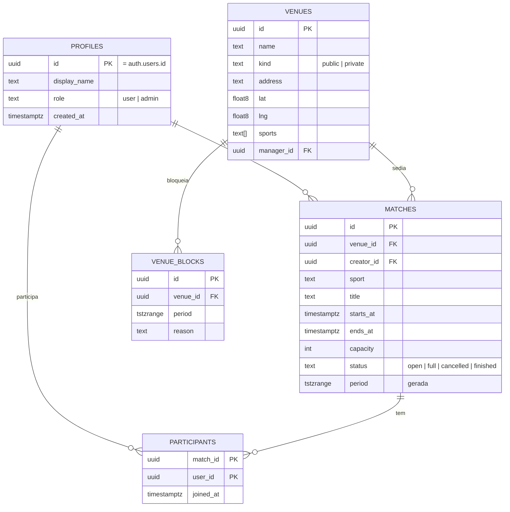

# OurinhosPlay — PRD

> Status: rascunho vivo • Fase atual: **Android (Kotlin + Jetpack Compose)** • iOS: documentado em [IOS-HANDOFF.md](IOS-HANDOFF.md), implementação adiada (requer macOS).
> Nome de trabalho. Pode mudar após validação.

---

## 1. Visão Geral e Posicionamento Estratégico

**Problema.** Em Ourinhos/SP, organizar uma pelada ou jogo recreativo é caótico: grupos de WhatsApp, "quem confirmou?", times incompletos, e dois grupos aparecendo na mesma quadra pública no mesmo horário.

**Solução.** App nativo que (1) lista jogos abertos por esporte, (2) deixa qualquer pessoa criar um jogo e confirmar presença em um toque, (3) mapeia quadras/arenas e (4) **impede dois jogos no mesmo local e horário dentro do app**.

**Posicionamento.** Dois eixos:
- *Civic hub*: base de quadras públicas da cidade com agenda visível. Quando houver parceria com a prefeitura, o app já é o ponto de coordenação.
- *Startup de esportes*: descoberta e organização de jogos, com gamificação leve ("Bora lá!").

**Princípio de execução.** Funcional antes de bonito, e Android primeiro. Sem depender de parceria externa: a agenda do app é a fonte da verdade e o dono da regra de anti-choque.

**Fora de escopo agora:** publicação em lojas, LGPD formal, otimização de cold start, mapa embutido, iOS. Estão registrados como dívida consciente na seção 12 e em [ROADMAP-DEBITOS.md](#12-roadmap-de-execução).

### Escopo do MVP (solo, enxuto)

Um MVP solo precisa ter o menor conjunto que prove o valor: *alguém cria jogo → outros veem → confirmam → sem choque de horário*.

| Dentro do MVP | Fica para depois |
|---|---|
| Login Google (+ e-mail/senha só para dev) | Login por SMS/telefone (custo + fraude) |
| Feed de jogos com filtro por esporte | Mapa embutido, rotas |
| Criar jogo + validação de choque no banco | Cache offline completo (Room) |
| Detalhe do jogo + lista de participantes | Telemetria avançada |
| Confirmar presença com vibração, som e confete | Reputação, ranking, conquistas |
| Meus Jogos (próximos / histórico) | Notificações push (FCM) — entra logo após o MVP |
| Cadastro de quadras (seed manual) | Painel admin completo (MVP usa role + tela mínima) |
| Distribuição por APK direto no celular | Play Store / App Store |

---

## 2. Personas e Jornadas

### 2.1 O Criador da Pelada (Carlos, 28)
Organiza futebol toda quinta. Hoje cobra confirmação no WhatsApp.
**Jornada:** abre o app → "Criar jogo" → escolhe esporte, quadra, data/hora, vagas → app valida choque → publica → compartilha link → acompanha confirmações → fecha lista.
**Dor:** time incompleto na véspera, quadra ocupada.

### 2.2 O Jogador Avulso (Bia, 22)
Joga vôlei/beach tennis, não tem grupo fixo.
**Jornada:** abre o app → filtra "Vôlei" → vê jogos próximos com vagas → toca "Bora lá!" → feedback tátil + som + confete → vê no "Meus Jogos".
**Dor:** não sabe onde tem jogo aberto.

### 2.3 O Gestor (Marcos, secretaria de esportes / dono de arena)
**Jornada:** entra com conta de role `admin` → vê jogos por quadra → resolve conflitos → bloqueia horários (manutenção/evento oficial).
**Dor:** reservas informais colidindo, sem visão da agenda.

---

## 3. Mapa de Telas e Navegação



Navegação: `NavigationSuiteScaffold`/`NavigationBar` Material 3 com 4 destinos. Detalhe e Criar sobem sobre a barra.

---

## 4. Fluxos Críticos

### 4.1 Autenticação sem fricção



**Por que Google e não SMS:** zero custo, sem provedor de SMS, sem fraude de SMS pumping, 1 toque no Android. O SMS OTP continua documentado como alternativa futura.

### 4.2 Criação de evento com checagem anti-choque



A validação **autoritativa está no banco** (seção 6). O cliente só antecipa UX; nunca é a única barreira, porque dois usuários podem criar ao mesmo tempo (race condition).

### 4.3 "Bora Lá" — entrada com feedback sensorial



Regras: respeitar modo silencioso (sem som) e preferência "reduzir animações" do sistema.

---

## 5. Especificação por Tela

### 5.1 Feed / Explorar
- **Layout:** `Scaffold` + `LazyColumn`; chips de filtro no topo (`FilterChip`): Todos, Futebol, Vôlei, Basquete, Beach Tennis.
- **Item (`MatchCard`):** esporte (ícone), título, quadra, data/hora relativa, vagas `x/y`, botão rápido.
- **Estados:** carregando (skeleton), vazio ("Nenhum jogo ainda — crie o primeiro"), erro de rede (retry), lista.
- **Ordenação:** início mais próximo primeiro; só jogos futuros e `status = open`.
- **Pull-to-refresh** + atualização ao voltar ao app.

### 5.2 Detalhe da Partida
- Cabeçalho: esporte, título, quadra (toca → "Abrir no Google Maps" via `geo:`/URL), data/hora, organizador.
- Lista de participantes (`LazyColumn`, avatar inicial + nome).
- Barra inferior: **Bora lá!** / **Sair** / **Lotado** (desabilitado) / **Encerrado**.
- Compartilhar: `Intent.ACTION_SEND` com texto + link.
- Organizador: editar, cancelar jogo.
- Erros: jogo removido (404), conflito de vaga, sem rede.

### 5.3 Modal Criar Evento + Validador de Quadra
- `ModalBottomSheet` ou tela cheia: esporte, quadra (dropdown de `venues`), data (`DatePicker`), hora (`TimePicker`), duração (60/90/120), vagas, descrição.
- Validador: ao escolher quadra+horário, consulta disponibilidade e mostra "Livre" / "Ocupado por X até HH:MM" e **sugestão do próximo horário livre**.
- Botão publicar só habilita com tudo válido; erro `23P01` do banco vira mensagem amigável.

### 5.4 Meus Jogos
- `TabRow`: **Próximos** | **Histórico**.
- Próximos: jogos em que confirmei ou criei, ordenados por data.
- Histórico: jogos passados; ações **Revanche** (clona com nova data) e **Novo jogo** (mesmo local/esporte).

### 5.5 Painel Admin (role `admin`)
- Lista de quadras → agenda do dia/semana.
- Conflitos: jogos sobrepostos (devem ser raros, mas aparecem por edição/migração).
- Ações: cancelar jogo (com motivo), **bloquear horário** na quadra, cadastrar/editar quadra.
- Acesso: `profiles.role = 'admin'` verificado por RLS no servidor. Telas só aparecem se role for admin, mas a segurança real é RLS.

---

## 6. Backend e Modelagem de Dados (Supabase / Postgres)



### 6.1 Anti-choque (núcleo)

```sql
create extension if not exists btree_gist;

alter table matches
  add column period tstzrange
  generated always as (tstzrange(starts_at, ends_at, '[)')) stored;

-- Dois jogos ativos não podem ocupar a mesma quadra ao mesmo tempo.
alter table matches
  add constraint matches_no_overlap
  exclude using gist (venue_id with =, period with &&)
  where (status in ('open','full'));
```

- `ends_at = starts_at + duração`, calculado na RPC `create_match`.
- Bloqueios de admin (`venue_blocks`) são checados na mesma RPC, antes do insert, e retornam erro de negócio distinto.
- `join_match(match_id)`: transação com `select ... for update` na partida, confere capacidade, insere em `participants` (PK composta impede duplicidade), atualiza `status = 'full'` se lotar.

### 6.2 RLS (resumo)
- `profiles`: leitura autenticada; update só do próprio.
- `venues`: leitura pública autenticada; escrita só `admin`.
- `matches`: leitura autenticada; insert via RPC; update/delete só criador ou `admin`.
- `participants`: leitura autenticada; insert/delete só via RPC (próprio `auth.uid()`).

### 6.3 Quadras sem parceria
Sem integração com a prefeitura, o app mantém **sua própria agenda**. Quadras públicas começam cadastradas manualmente (seed). A regra "primeiro que reservar no app leva" é clara e documentada para o usuário. Admin pode bloquear horários oficiais.

---

## 7. Integrações Nativas (Android)

| Recurso | API | Observação |
|---|---|---|
| Login | Credential Manager + `googleid` → `signInWith(IDToken)` | Substitui o SMS Retriever |
| Vibração | `VibratorManager` / `VibrationEffect` | Padrão curto de sucesso; checar `hasVibrator()` |
| Som | `SoundPool` com `res/raw/bora_la.ogg` | Respeitar `AudioManager.ringerMode` |
| Confete | `Canvas` em Compose + `Animatable` | Sem biblioteca externa |
| Compartilhar | `Intent.ACTION_SEND` | Texto + deep link |
| Abrir mapa | `Intent(ACTION_VIEW, geo:lat,lng?q=...)` | **Substitui o mapa embutido por enquanto** |
| Push | FCM | Pós-MVP |

### Alternativa ao mapa embutido (decisão)
1. **Agora:** cada quadra tem endereço + botão "Abrir no Maps" (intent `geo:`). Custo zero, sem chave de API, funciona hoje.
2. **Depois (opcional, ainda grátis):** MapLibre/osmdroid com tiles OpenStreetMap. Evita o billing obrigatório do Google Maps SDK.

---

## 8. Cache Local e Offline
- **MVP:** sessão e preferências em DataStore. Listas só online com estado de erro/retry.
- **Pós-MVP:** Room como cache do feed e "Meus Jogos" (leitura offline); mutações sempre exigem rede.

## 9. Segurança
- Tokens da sessão: storage do SDK Supabase sobre `DataStore` com chave no **Android Keystore** (AES-GCM via Tink). `EncryptedSharedPreferences` está deprecated.
- Chaves: só a `anon key` do Supabase vai no app (é pública por design; a segurança é RLS). **Nunca** `service_role` no app.
- Configuração local em `secrets.properties` (ignorado pelo git) → `BuildConfig`.
- `allowBackup=false` no manifesto.
- LGPD: ver seção "Dívidas conscientes" — não é foco agora, mas o desenho (dados mínimos: nome de exibição + e-mail do Google) já facilita a conformidade depois.

## 10. Acessibilidade
- `contentDescription` em todos os ícones/botões de ação; `semantics` na lista de participantes.
- Alvos de toque ≥ 48dp; contraste AA; suporte a fonte grande.
- Confete e vibração desligam com "remover animações" / sem vibrador.
- Teste manual com TalkBack a cada sprint de UI.

## 11. Telemetria e Erros
- **Agora:** `Log` + tela de diagnóstico simples (versão, usuário, último erro).
- **Depois:** Firebase Crashlytics (gratuito) + eventos-chave (`create_match`, `join_match`, `conflict_blocked`).

---

## 12. Roadmap de Execução

Cada sprint termina com um **APK instalado e testado no celular**.

### Sprint 0 — Ambiente e pipeline ✅/⬜
- [x] JDK 17 instalado e verificado (`java -version`)
- [x] Android SDK (platform-tools, android-35, build-tools 35) + licenças
- [x] `ANDROID_HOME` / `JAVA_HOME` configurados
- [x] Projeto Compose "Hello" compila (`gradlew :app:assembleDebug`)
- [x] APK gerado e validado com `aapt2 dump badging`
- [ ] Android Studio instalado e abre o projeto
- [ ] Celular com depuração USB/Wi-Fi autorizado (`adb devices` lista o aparelho)
- [ ] `adb install -r` instala e o app abre mostrando "Pipeline OK"
- [ ] Repositório Git com primeiro commit
- [ ] Projeto Supabase criado; URL + anon key em `secrets.properties`

### Sprint 1 — Auth
- [ ] Projeto no Google Cloud: tela de consentimento + OAuth Client Web e Android (SHA-1 debug)
- [ ] Provider Google habilitado no Supabase Auth
- [ ] Dependências: supabase-kt (auth, postgrest), Credential Manager, googleid
- [ ] Tela Login + botão Google funcionando
- [ ] Tabela `profiles` + trigger de criação + RLS
- [ ] Tela "Nome de exibição" (primeira vez)
- [ ] Sessão persistente entre aberturas; logout
- [ ] Fallback e-mail/senha apenas em build debug

### Sprint 2 — Quadras e Feed
- [ ] Migration `venues` + seed de quadras de Ourinhos
- [ ] Migration `matches` + `participants` + constraint de exclusão
- [ ] `NavigationBar` com 4 destinos
- [ ] Feed com filtros por esporte + estados (loading/vazio/erro)
- [ ] Lista de Quadras + "Abrir no Maps"

### Sprint 3 — Criar jogo + anti-choque
- [ ] RPC `create_match` com cálculo de `ends_at`
- [ ] Modal de criação com DatePicker/TimePicker
- [ ] Validador "Livre/Ocupado" + próximo horário livre
- [ ] Teste: dois usuários criando o mesmo horário → um é recusado
- [ ] Teste: jogo sobreposto parcialmente é recusado

### Sprint 4 — Detalhe + "Bora lá"
- [ ] Tela de detalhe + lista de participantes
- [ ] RPC `join_match` / `leave_match` transacionais
- [ ] `FeedbackManager` (vibração + SoundPool)
- [ ] Confete em Canvas
- [ ] Respeito a modo silencioso e "reduzir animações"
- [ ] Teste de lotação concorrente

### Sprint 5 — Meus Jogos e compartilhamento
- [ ] Abas Próximos / Histórico
- [ ] Revanche / Novo jogo
- [ ] Compartilhar jogo (texto + link)
- [ ] Editar/cancelar jogo (criador)

### Sprint 6 — Admin
- [ ] Role `admin` + RLS
- [ ] Agenda por quadra
- [ ] Bloqueio de horário (`venue_blocks`)
- [ ] Cancelar jogo com motivo

### Sprint 7 — Qualidade
- [ ] Pass de acessibilidade (TalkBack)
- [ ] Crashlytics
- [ ] Push (FCM) para "jogo confirmado/cancelado"
- [ ] Ícone e nome finais

### Dívidas conscientes (adiadas por decisão)
- [ ] LGPD: política de privacidade, exclusão de conta no app, consentimento de localização
- [ ] Publicação Play Store (Data Safety, assinatura de release)
- [ ] Cold start < 1.5s (Baseline Profiles)
- [ ] Mapa embutido (MapLibre + OSM)
- [ ] Cache offline (Room)
- [ ] iOS (Swift/SwiftUI) — ver [IOS-HANDOFF.md](IOS-HANDOFF.md)
- [ ] Login por telefone/SMS (se virar necessidade)

### Ideias pós-MVP (registradas, não priorizadas)
- [ ] **Placar e gols por partida:** o organizador (ou os jogadores) registra o resultado e quem fez cada gol. Visível só para os participantes do jogo, nunca no feed público.
- [ ] **Modo torneio (privado):** jogos agrupados em torneio com tabela, artilharia e classificação, visível apenas para os inscritos.
- [ ] **Gamificação amigável:** foco em reconhecimento positivo, sem ranking público de "piores". Ex.: sequência de presença, medalhas de participação ("Primeira pelada", "Organizador de 5 jogos"), artilheiro do mês só entre amigos. Sem punição por faltar nem comparação com desconhecidos.

### Mapeamento de quadras e locais (fazer junto do cadastro real de Ourinhos)
Decisões do dono do produto, para não perder:
- [ ] **Um local pode ter várias quadras.** Hoje `venues` é "o lugar" e o anti-choque é por `venue_id`. Criar `courts` (quadra 1, quadra 2...) ligada a `venues`, e mover o anti-choque e `matches.venue_id` para `court_id`. Detalhe: dois jogos no mesmo local em quadras diferentes **não** conflitam.
- [ ] **Pago x gratuito:** `kind` já separa `public`/`private`. Acrescentar preço (por hora ou por pessoa), forma de contato/reserva, horário de funcionamento e público (aberto, só associados, só alunos).
- [ ] **Preço visível** no card da quadra e na criação do jogo (estimativa por jogador = preço / vagas).
- [ ] **Seed real:** substituir os 3 placeholders pelas quadras de Ourinhos com endereço e coordenadas.

### Equipamento por jogo (decisão pendente de modelagem)
Avaliação: **vale como campo opcional**, não obrigatório. É relevante em quadra pública (ninguém fornece bola/rede) e irrelevante em arena paga que empresta material.
- [ ] `matches.equipment` (lista): bola, rede, coletes, bomba de ar, conforme o esporte. Cada item com "quem leva" (organizador ou voluntário que toca em "eu levo").
- [ ] Sugestão automática por esporte (futebol: bola e coletes; vôlei: bola e rede; basquete: bola; beach tennis: raquetes, bola e rede).
- [ ] Esconder o bloco quando a quadra marcar "fornece equipamento".

### Experiência do dia do jogo (ideias)
- [x] Contagem regressiva ao vivo no detalhe e notificação com cronômetro (feito na sprint 4).
- [ ] **Check-in "Cheguei":** botão aparece perto do horário; confirmar chegada manual ou por proximidade (geofence com permissão de localização). A notificação do cronômetro some ao fazer check-in.
- [ ] **Quem já chegou:** lista mostra quem fez check-in ("3 de 10 no local").
- [ ] **Chamada no vestiário:** organizador manda aviso curto para os confirmados ("chegando em 10 min").
- [ ] Som de apito e "GOOOL!" já na entrada (feito); apito diferente de fim de jogo (futuro).
